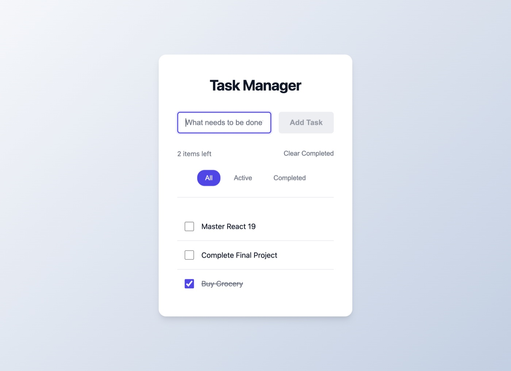

<p align="center">
  
</p>

<h1 align="center">Task Manager</h1>

<p align="center">
  <b>A small React exercise, done properly: one source of truth, presentational children, and state that survives a reload.</b><br>
  <sub>React 19 · Vite · CSS Modules · no state library</sub>
</p>

<p align="center">
  
  
  
</p>

---


A robust, functional Task Manager application built with **React 19** and **Vite**. This project demonstrates modern React best practices, including functional components, hooks, unidirectional data flow, and persistent local storage.

## 🚀 Installation & Setup

Follow these steps to run the project locally:

1.  **Clone or Download source code.**
2.  **Open your terminal** in the project directory.
3.  **Install dependencies:**
    ```bash
    npm install
    ```
4.  **Start the development server:**
    ```bash
    npm run dev
    ```
5.  **Access the app:**
    Open your browser and navigate to the URL shown in the terminal (usually `http://localhost:5173`).

## 🏗 Component Architecture

The application follows a modular component structure to ensure separation of concerns:

*   **`App`**: The root component. It acts as the "Source of Truth," managing the global `tasks` state, `filter` state, and persistence logic.
*   **`TaskInput`**: A controlled component responsible for capturing user input and dispatching the "Add Task" event.
*   **`TaskList`**: A pure presentational component that receives the filtered list of tasks and renders them.
*   **`TaskItem`**: Represents a single task row. Handles individual task interactions like toggling completion, editing text, and deletion.
*   **`TaskFilter`**: Provides the UI for filtering tasks (All / Active / Completed) and updates the filter state in the parent.

## ✨ Features

*   **Add Tasks**: Users can add new to-do items. Validation prevents adding empty tasks.
*   **Toggle Completion**: Tasks can be marked as active or completed interactively.
*   **Edit Tasks**: Double-click (or use the UI) to edit an existing task's text inline.
*   **filters**: dynamic filtering to show "All", "Active", or "Completed" tasks.
*   **Data Persistence**: Logic automatically saves tasks to the browser's **LocalStorage**, ensuring data survives page reloads.
*   **Task Counter**: Real-time display of the number of active tasks remaining.
*   **Clear Completed**: "One-click" cleanup of all finished tasks.

## 🛠 Tech Stack

*   **Framework**: React 19 (Functional Components + Hooks)
*   **Build Tool**: Vite
*   **Styling**: CSS Modules (Scoped styling for components)
*   **State Management**: React `useState` & `useEffect` (No external libraries)
*   **persistence**: LocalStorage API

## 🐛 Known Limitations / Bugs

*   **identified** Data persistence relies on browser LocalStorage, meaning data is not shared across devices and will be lost if the browser cache is cleared.


